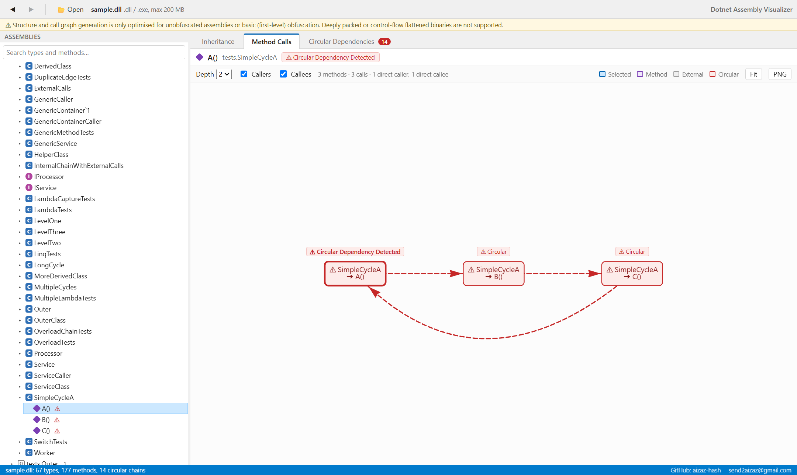
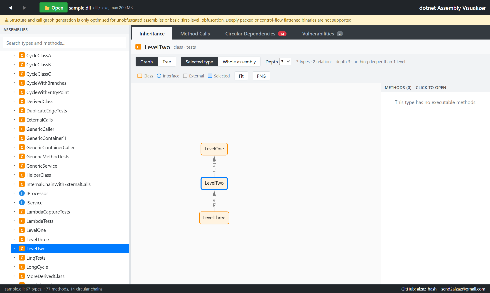
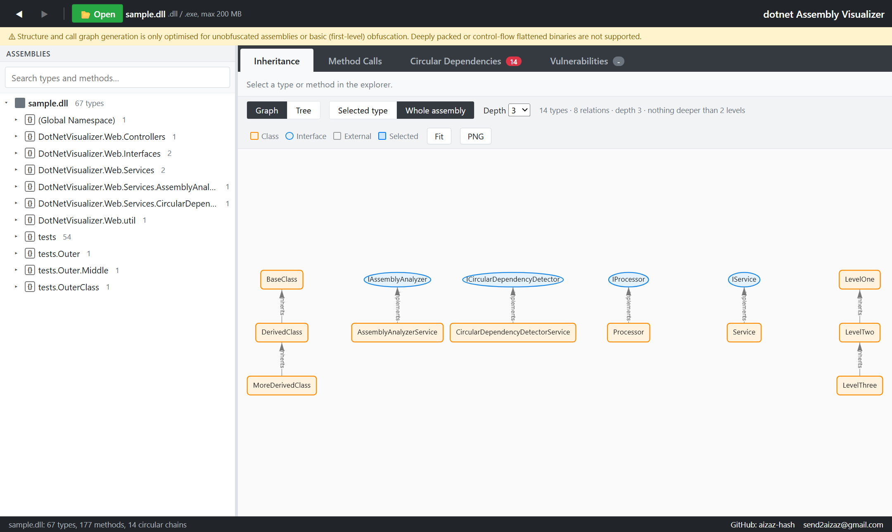
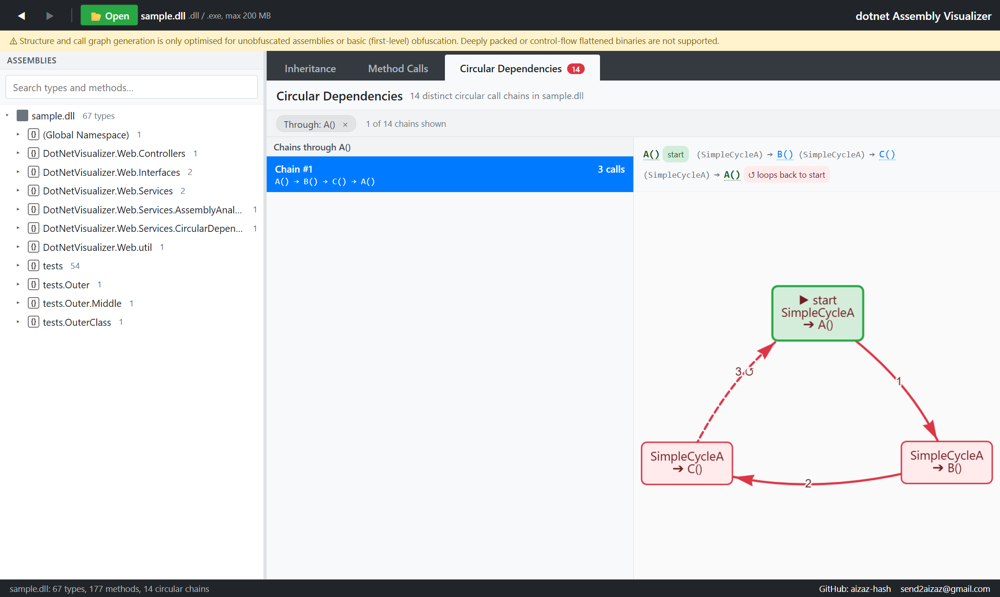
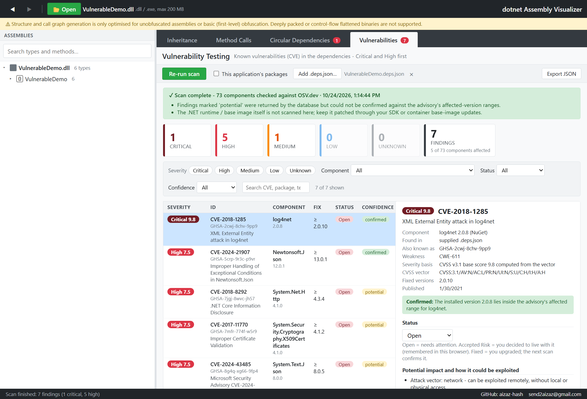
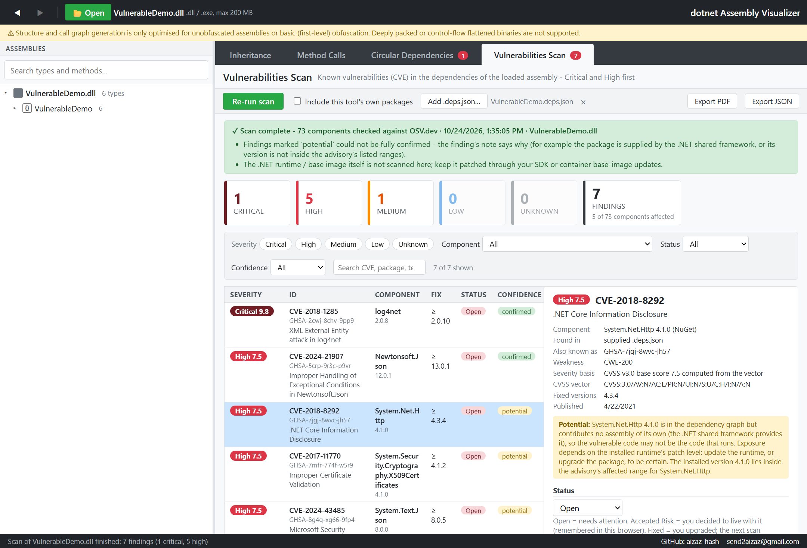

# .NET Assembly Visualizer

Explore the architecture of a .NET assembly in seconds - inheritance graphs, method call graphs, circular call chains and known vulnerabilities in its dependencies - without loading or running the assembly.

I built this tool because I was tired of staring at massive, unreadable dependency graphs when trying to understand how the parts of a complex .NET assembly talk to each other. It reads the DLL binary directly (`System.Reflection.Metadata` plus IL scanning), so there is no runtime overhead and no slow loading.



*The screenshots on this page show a small sample assembly.*

---

## Contents

- [Features](#features)
- [Quick start](#quick-start)
- [Using the UI](#using-the-ui)
- [Configuration](#configuration)
- [How it works](#how-it-works)
- [Project structure](#project-structure)
- [Releasing](#releasing)
- [License](#license)
- [Contributing and contact](#contributing-and-contact)

---

## Features

### Assembly explorer and inheritance view

An ILSpy-style explorer on the left (assembly → namespaces → types → base types, derived types and methods) with search and Back / Forward navigation. The **Inheritance** tab draws the selected type's base types, interfaces and derived types as an interactive **graph** (bases above, derived types below, dashed lines for interface implementations). Use *Depth* to control how many levels are shown, double-click a type to centre the graph on it, and use *Fit* or *PNG* to zoom or export. A **Tree** toggle switches to an expandable list of the same relationships if you prefer it.



The **Whole assembly** mode draws every type hierarchy of the assembly in one graph (capped at 300 types for readability; the tree view lists all of them and expands lazily).



### Method calls

Pick a method to see its callers and callees (depth 1-4). Each method appears **once**, however many paths lead to it; repeated calls are merged into a single `×N` edge. Double-click a node to re-centre the graph on it.

### Circular dependency detection

Methods that take part in a circular call chain are marked in the explorer and get a clickable **⚠ Circular Dependency Detected** marker above them in the call graph (see the first screenshot). Clicking it opens the dedicated view: every distinct chain through that method, e.g. `A() → B() → C() → A()`, with the start and the loop-back marked. Click any method in a chain to jump back to its call graph.



### Vulnerabilities Scan

The **Vulnerabilities Scan** tab checks the dependencies of the assembly you have loaded for known security vulnerabilities and puts **Critical and High** findings first. It looks up the *exact* package versions in [OSV.dev](https://osv.dev) (GitHub Security Advisories, NVD and others) - nothing is executed, installed or modified.



- **What is scanned:** the dependencies of the loaded assembly, with exact versions, from the `.deps.json` that was built with it (add it with *Add .deps.json…*). You can also tick *Include this tool's own packages*. The scan needs a loaded assembly: its result belongs to that assembly, is kept while you switch between assemblies, and disappears when you remove it. The assemblies referenced by the loaded DLL are listed too, but not matched to packages (an assembly reference only carries an assembly version such as `8.0.0.0`, which does not identify the NuGet package version).
- **What you get for every finding:** CVE / GHSA identifier, CVSS score and severity (computed from the CVSS v3 vector, or the advisory's own rating when only a v4 vector is published), affected component and version, the weakness (CWE), potential impact and exploitation conditions derived from the vector, fixed versions, a recommended upgrade with a command *for you to run*, the advisory text and references.
- **Summary and filters:** counts per severity (click a card to filter), filters for severity, component, status and confidence, plus text search. Statuses are **Open**, **Accepted Risk** and **Fixed**; a finding you mark as fixed re-opens automatically if the next scan still reports it. Reports can be exported as **PDF** (the browser's print dialog - choose *Save as PDF*) or as JSON.
- **Confirmed vs potential:** every finding is verified against the advisory's affected-version ranges. It is *confirmed* when the exact version is in range and the package really ships code. It is *potential* when that cannot be established - for example a legacy `System.*` package that the .NET shared framework supplies at runtime, so the vulnerable code may not be what runs.



- **Honest about gaps:** if the database cannot be reached, a component fails, or an advisory cannot be downloaded, the report says the scan is **incomplete** instead of showing "no vulnerabilities". The .NET runtime / base image itself is not scanned.
- **No manifest needed:** the scan starts from the loaded assembly's own references (level 1), matches them to NuGet packages, then follows each package's declared dependencies down to **level 4** (level 0 is the assembly itself). Every dependency is listed once with its level, where its version came from (exact from a `.deps.json`, estimated from the assembly version, or the lowest version the parent accepts) and a plain status: *Assembly discovered*, *Package identified*, *Version identified*, *Vulnerability found*, *Vulnerability lookup unavailable* or *Dependency could not be resolved*. Findings with an estimated version are marked *potential*; adding the `.deps.json` makes versions exact.
- **Manifests:** add a `.deps.json`, `obj/project.assets.json` or `packages.lock.json` for exact versions - they also carry the dependency graph, so every package gets its level (and indirect packages are covered). Opening a folder or archive picks the right one automatically.
- **Privacy:** only package names and versions are sent to `api.osv.dev` and, to find a package's dependencies, `api.nuget.org` - never your code or assemblies - and the UI asks for confirmation before the first scan. Set `Vulnerability:Enabled` to `false` to switch the feature off (for air-gapped use).
- **Try it:** `samples/VulnerableDemo` is a deliberately vulnerable test assembly (log4net 2.0.8, Newtonsoft.Json 12.0.1, System.Text.Json 8.0.0). Build it, open the DLL and press *Run scan* (no `.deps.json` needed). See [samples/VulnerableDemo/README.md](samples/VulnerableDemo/README.md).

### More

- Open an assembly with the **Open** button or by dragging a `.dll` / `.exe` onto the page; several assemblies can be loaded at once. You can also open a **NuGet package (`.nupkg`)**, a **`.zip`** or a whole **folder** (the **Folder** button, or drop a folder): the best `lib/<framework>` assembly of a package, or the application assemblies of a publish folder, are opened (copies of the .NET framework are skipped, up to 8 at once) and the `.deps.json` that comes with them is used automatically for exact package versions in the Vulnerabilities Scan. They are listed in the explorer; click one to switch, and right-click it (or use the ✕ on hover) to **Reload** or **Remove** it.
- **Fit** and **PNG** export for graphs; the UI works offline (`vis-network` is bundled).
- Helpful errors for native or corrupt DLLs and a configurable upload limit.
- Fully offline UI (except the optional vulnerability lookup).

---

## Quick start

### Docker (no .NET install required)

```bash
docker run --rm -p 8080:8080 ghcr.io/aizaz-hash/dotnet-visualizer-web:latest
```

Then open **http://localhost:8080** and upload a `.dll`. To use another host port, change the left side, e.g. `-p 5000:8080`.

To build the image yourself:

```bash
docker build -t dotnet-visualizer .
docker run --rm -p 8080:8080 dotnet-visualizer
```

The image has a `HEALTHCHECK` on `/healthz`; `docker ps` shows `healthy` once the app is up.

### Prebuilt downloads (no .NET install required)

Download the self-contained build for Windows (x64) or Linux (x64) from the [Releases page](https://github.com/Aizaz-hash/dotnet-Assembly-Visualizer/releases), extract it and run the `dotnet-Assembly-Visualizer` executable. The app listens on port 8080.

### From source

Requires the [.NET 8 SDK](https://dotnet.microsoft.com/download/dotnet/8.0).

```bash
git clone https://github.com/Aizaz-hash/dotnet-Assembly-Visualizer
cd dotnet-Assembly-Visualizer
dotnet run
```

Then open **http://localhost:8080**. (To run the `v2` line, `git checkout v2` first.)

### Windows service

`scripts/win/installer.ps1` publishes a self-contained build to `C:\DAV` and installs it as an auto-start Windows service (service name `DAV`, port 9999). Run it from an elevated PowerShell in the repository root.

---

## Using the UI

| Area | What it does |
|---|---|
| **Toolbar** | *Open* an assembly, package or zip, *Folder*, Back / Forward (Alt+Left / Alt+Right). |
| **Explorer** | Lists the loaded assemblies (right-click: Reload, Remove); browse namespaces, types and methods; search for types and methods; methods in a circular chain carry a red ⚠. |
| **Inheritance** | Graph (or tree) of base types, interfaces and derived types for the selected type, or for the whole assembly; adjustable depth. |
| **Method Calls** | Callers and callees of the selected method; adjustable depth; merged nodes and edges. |
| **Vulnerabilities Scan** | Scan the loaded assembly's dependencies (levels 1-4, no manifest needed) against OSV.dev; summary by severity, filters, details, remediation, status tracking, PDF and JSON export. |
| **Circular Dependencies** | Every distinct circular call chain, grouped by class; filter to a single method; click to jump to its call graph. |

Graph generation is optimised for unobfuscated assemblies or basic (first-level) obfuscation. Deeply packed or control-flow-flattened binaries are not supported.

---

## Configuration

| Setting | Default | Notes |
|---|---|---|
| `Urls` | `http://*:8080` | Where the app listens. The Docker image pins it to `8080` through an environment variable. |
| `Upload:MaxFileSizeMB` | `200` | Maximum assembly size. Set it in `appsettings.json` or with the environment variable `Upload__MaxFileSizeMB`, e.g. `docker run -e Upload__MaxFileSizeMB=500 ...`. The UI shows the active limit next to *Open*. |
| `Vulnerability:Enabled` | `true` | Switch the vulnerability lookup off (e.g. air-gapped). Env var: `Vulnerability__Enabled`. |
| `Vulnerability:OsvBaseUrl` | `https://api.osv.dev/` | Vulnerability database endpoint (OSV API). |
| `Vulnerability:NuGetBaseUrl` | `https://api.nuget.org/v3-flatcontainer/` | NuGet flat container used to find packages and their dependencies. |
| `Vulnerability:TimeoutSeconds` | `20` | Timeout for each database request. |

Endpoints: `POST /api/analysis/analyze` (analyse an uploaded assembly), `GET /api/analysis/limits`, `POST /api/vulnerabilities/scan`, `GET /api/vulnerabilities/status`, `GET /healthz`.

---

## How it works

- **Engine:** reads the PE metadata and scans IL bytes for `call` and `callvirt` opcodes to build the inheritance and call graphs; lambdas and compiler-generated methods are resolved back to the source methods that contain them.
- **Circular chains:** detected with a depth-first search over the call graph; the UI merges rotations of the same cycle so each chain is listed once.
- **Backend:** ASP.NET Core with a modular structure (`Controllers`, `Services`, `Interfaces`); `IAssemblyAnalyzer` and `ICircularDependencyDetector` are registered through dependency injection.
- **Frontend:** plain HTML, CSS and JavaScript with [vis-network](https://visjs.github.io/vis-network/) for graphs.

---

## Project structure

```
Controllers/     HTTP API (AnalysisController)
Services/        AssemblyAnalyzerService, CircularDependencyDetectorService
Interfaces/      IAssemblyAnalyzer, ICircularDependencyDetector
Services/Vulnerabilities/   OSV + NuGet clients, dependency resolver (levels 1-4), CVSS calculator, version ranges, scanner
util/            shared helpers
wwwroot/         index.html, css/, js/, lib/ (bundled vis-network)
test-classes/    sample classes used to test the analyzer
tests/           unit and API tests (xUnit) and tests/js (node --test: depth model, graph layout, UI logic)
tools/PerfPoc/   per-stage timing benchmark for the analyzer (see docs/performance/PERFORMANCE_REPORT.md)
samples/         VulnerableDemo - a deliberately vulnerable test assembly
scripts/win/     Windows service installer
docs/images/     screenshots used in this README
.github/         CI and release workflows
```

---

## Testing

```bash
dotnet test tests/DotNetVisualizer.Web.Tests -c Release
node --test tests/js/*.test.js
```

The suite covers the CVSS calculator (reference scores), version-range matching, the scanner (confirmed vs potential, incomplete scans, duplicates, withdrawn advisories) with a fake database, the OSV client, the dependency resolver (levels 1-4, cycles, duplicates, missing package/version metadata, outages, a vulnerability at every level) with a fake NuGet, the analyzer's stage timings and the HTTP API. The `node --test` suite covers the shared depth model, the Method View layout, double-click handling and the loader stages. Neither needs network access; CI runs it on every pull request.

---

## Releasing

Releases are built by the *Release* workflow and always use the **current tip of the release branch** (`main` for `0.x`, `v2` for `2.x`):

1. Merge everything for the release into the release branch.
2. GitHub → *Actions* → *Release* → *Run workflow*, choose the branch and enter the version (e.g. `2.0.1`). The workflow builds that branch's latest commit, publishes the GHCR image and the archives, and creates or moves the tag `v<version>` onto exactly that commit.

Pushing a tag by hand also works, but the workflow fails if the tag is not the tip of its release branch, so a stale tag cannot publish old code. Each release page states the branch and commit it was built from.

---

## License

This project is released under the **[MIT License](LICENSE)** - Copyright (c) 2026 Aizaz Zaheen.

The MIT License is a permissive, free-software license. Under its terms you may use, copy, modify, merge, publish, distribute, sublicense and sell copies of this software - for personal, educational and commercial purposes - free of charge, provided that the copyright notice and the permission notice are included in all copies or substantial portions of the software. The software is provided "as is", without warranty of any kind. See the [LICENSE](LICENSE) file for the full text.

---

## Contributing and contact

Bug reports, ideas and pull requests are welcome - open an issue or a PR on [GitHub](https://github.com/Aizaz-hash/dotnet-Assembly-Visualizer). I'd love to hear how you're using it.

- **GitHub:** [aizaz-hash](https://github.com/aizaz-hash)
- **Email:** [send2aizaz@gmail.com](mailto:send2aizaz@gmail.com?subject=Assembly%20Visualizer)

*Built by [Aizaz](https://github.com/aizaz-hash) - happy coding!*
