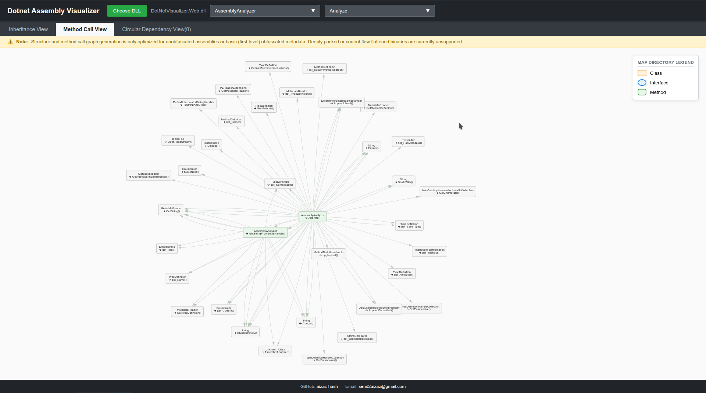

# .NET Assembly Architecture Profiler

I built this tool because I was tired of staring at massive, unreadable dependency graphs when trying to debug or understand how different parts of a complex .NET assembly talk to each other. 

Most profilers require you to load the assembly into a running environment, which is slow, heavy, and overkill for a quick analysis. This tool takes a different approach—it reads the DLL binary directly, parses the metadata, and lets you visualize the architecture in seconds.

---

## 🚀 Quick Start
Run the latest published image — no .NET install required:

```bash
docker run --rm -p 8080:8080 ghcr.io/aizaz-hash/dotnet-visualizer-web:latest
```

Then open **http://localhost:8080** and upload your `.dll`.

---

## 📸 See it in action


---

## Why I built this
* **Keep it lightweight:** It uses `System.Reflection.Metadata` to parse your DLL files directly. No runtime overhead, no slow loading times.
* **Cut through the noise:** If you’ve ever used a visualizer, you know they usually turn into a "spaghetti mess" of nodes. I added a surgical filter so you can pick *one* method and see exactly who calls it (and who it calls) without the extra clutter.
* **See the flow:** You can switch between a high-level **Inheritance View** (to see how your classes are structured) and a **Method View** (to trace actual execution flow).

---

## 🛠 What's under the hood
* **Backend:** ASP.NET Core Minimal APIs for speed.
* **Engine:** Raw metadata and IL byte scanning (looking for those `call` and `callvirt` opcodes).
* **Frontend:** A clean, responsive interface powered by `vis-network` for that "physics-based" layout feel.

---

## How to use it
1.  **Clone the repo:** `git clone https://github.com/aizaz-hash/Dotnet-Visualizer-Web`
2.  **Fire it up:** Just run `dotnet run`.
3.  **Explore:** Upload your `.dll`, pick a class, and start digging into the dependencies.

---

## 🐳 Running with Docker
The image pins the .NET version internally, so you don't need any specific .NET SDK/runtime installed on the host.

```bash
# Build the image
docker build -t dotnet-visualizer .

# Run it (the app listens on port 8080 inside the container)
docker run --rm -p 8080:8080 dotnet-visualizer
```

Then open **http://localhost:8080** and upload your `.dll`.

> The container port is set by the `"Urls"` value in `appsettings.json`. To map a different host port, change the left side, e.g. `-p 5000:8080`.

---

## Let’s connect
I’m actively working on this, so if you find a bug or have an idea for a feature that would make your life easier, please reach out! I’d love to hear how you're using it.

* **GitHub:** [aizaz-hash](https://github.com/aizaz-hash)
* **Email:** [send2aizaz@gmail.com](mailto:send2aizaz@gmail.com?subject=Assembly%20Architecture%20Profiler%3F)

---
*Built by [Aizaz](https://github.com/aizaz-hash) — Happy coding!*
