# .NET Assembly Visualizer

Understand a .NET assembly in seconds - what it is, how its parts depend on each other, who calls what (with the decompiled C# next to it), what looks risky, what changed between two versions and which of its dependencies have known vulnerabilities - without loading or running it.

I built this tool because I was tired of staring at massive, unreadable dependency graphs when trying to understand how the parts of a complex .NET assembly talk to each other. It reads the DLL binary directly (`System.Reflection.Metadata` plus IL scanning), so there is no runtime overhead and no slow loading.

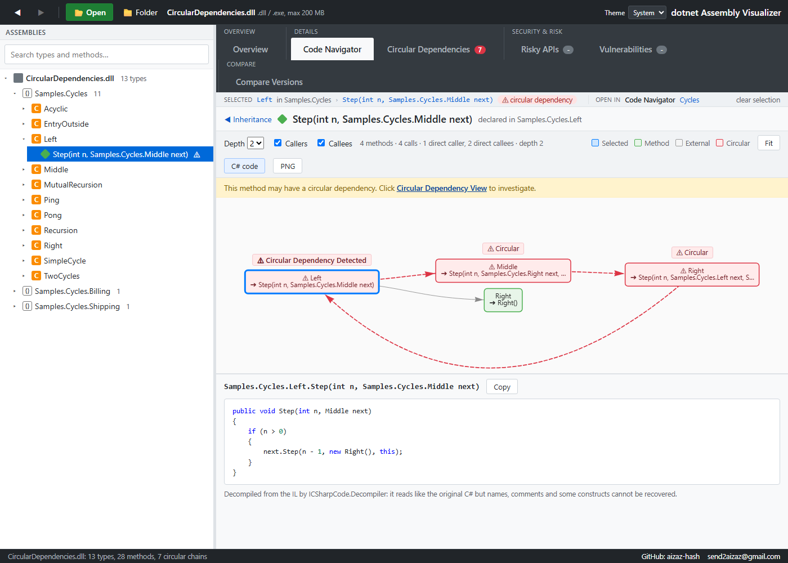

*The screenshots on this page show small sample assemblies, in the light and the dark theme. This is the v3 interface (see the [release notes](docs/release/release-notes-v3.0.0.md)); the v2 line stays available on its own branch.*

---

## Contents

- [Features](#features)
- [Quick start](#quick-start)
- [Using the UI](#using-the-ui)
- [Configuration](#configuration)
- [How it works](#how-it-works)
- [Command line and CI](#command-line-and-ci)
- [Project structure](#project-structure)
- [Testing](#testing)
- [Releasing](#releasing)
- [License](#license)
- [Contributing and contact](#contributing-and-contact)

---

## Features

- **Overview** of the assembly: identity, target framework, signing, obfuscation indicators, the **architecture** of its namespaces and its code **metrics**.
- **Code Navigator**: pick a class for its **inheritance**, a method for its **callers and callees** - each with the **decompiled C#** underneath.
- **Circular dependencies**: every distinct circular call chain, with the exact path.
- **Risky APIs** (leads for a security review) and **Vulnerabilities** (known CVEs in the dependencies, scanned in the background).
- **Compare Versions**: what changed in the public API between two versions, and what can break callers.
- **Light, Dark and System** themes.
- Opens a DLL or EXE, a folder, a NuGet package or a zip; works offline (except the optional vulnerability lookup); runs headless in CI.

### Overview, architecture and metrics

The first screen after you open an assembly. **Summary** says what the assembly is - name, version, full name, target framework, strong-name status with its public key token, module id, debug or release build, references - shows the **obfuscation indicators** (evidence, never a verdict, with a standing warning about what the analysis cannot do on obfuscated code) and "At a glance" cards that each open the matching view. **Architecture** draws how the namespaces depend on each other and where they depend on each other in a circle. **Metrics** lists complexity hotspots, the most-called and most-dependent methods, the largest types and the methods nothing references.

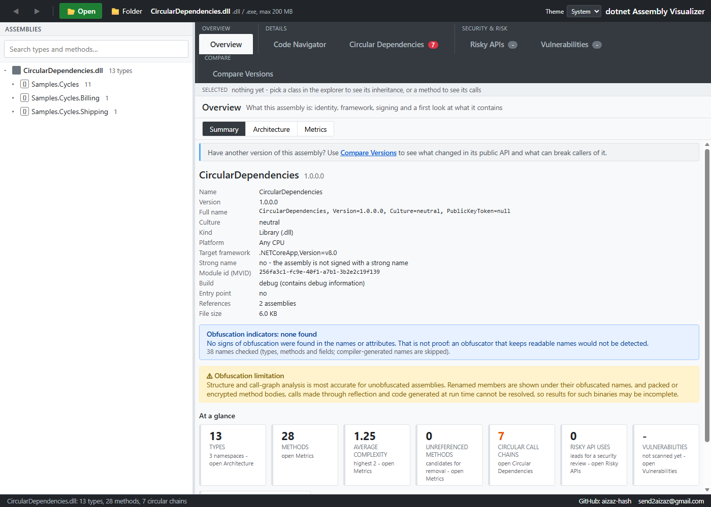

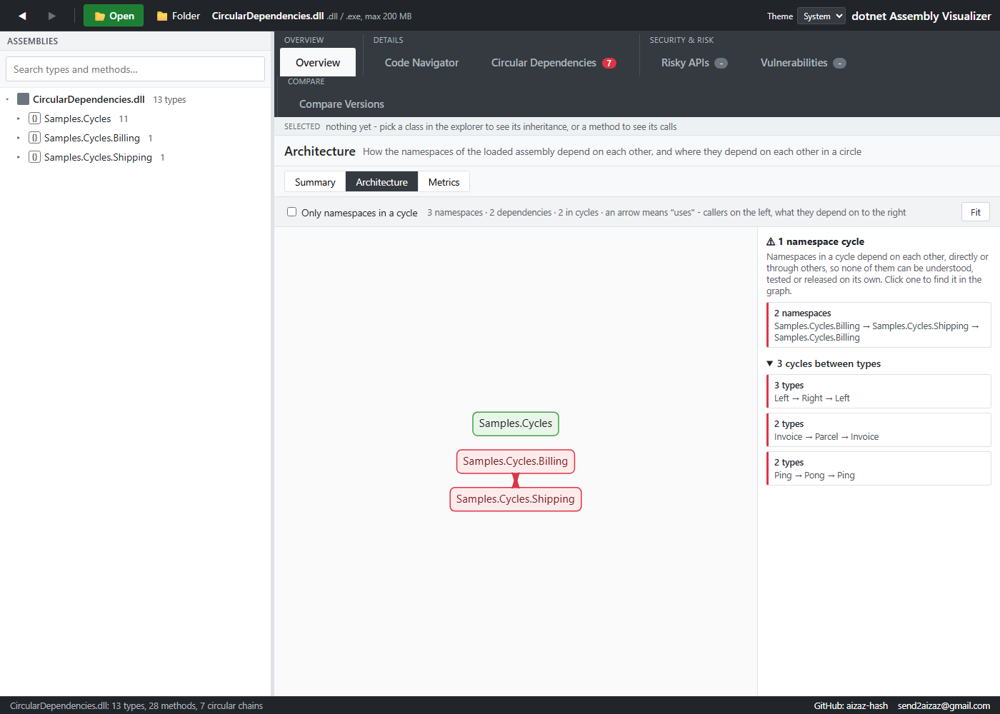

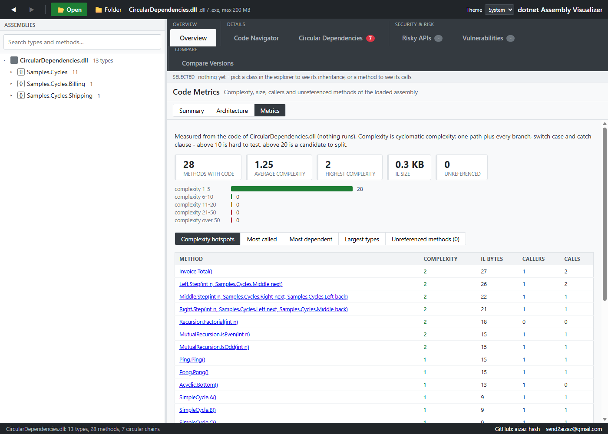

Before anything is open, the Overview is an introduction with the two ways to start: open an assembly or compare two versions.

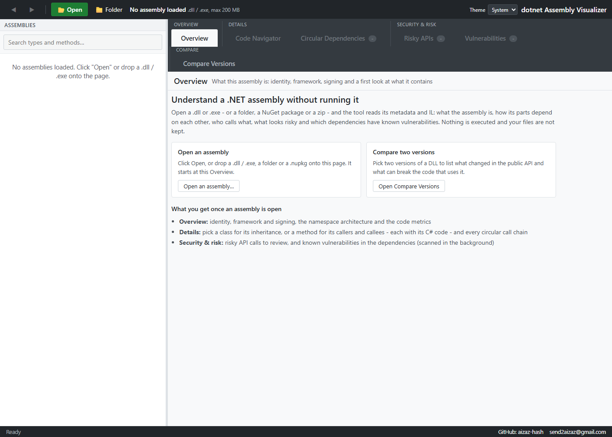

### Assembly explorer and Code Navigator

An ILSpy-style explorer on the left (assembly → namespaces → types → base types, derived types and methods) with search and Back / Forward navigation. What you pick decides what the **Code Navigator** shows - and the C# of it is always underneath:

- **A class** shows its **inheritance** as an interactive graph (bases above, derived types below, dashed lines for interface implementations), or as a tree, or for the **whole assembly** (capped at 300 types for readability; the tree lists all of them). *Depth* controls how many levels are shown; double-click a type to centre the graph on it; *Fit* and *PNG* zoom and export.
- **A method** shows its **callers and callees** (depth 1-4). Each method appears once, however many paths lead to it; repeated calls are merged into a single `×N` edge. A property getter or setter shows its property declaration.

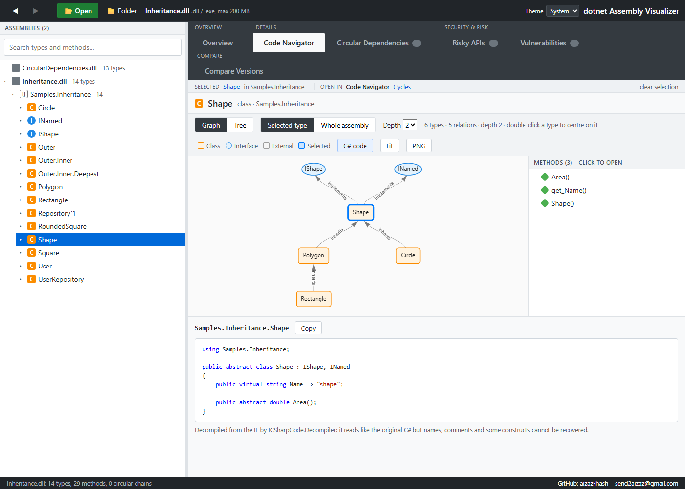

The selection never changes by itself: moving between the Navigator and the Circular Dependencies view keeps the same class or method, and the **Selected** bar above every view links to the others.

### Circular dependency detection

Methods that take part in a circular call chain are marked in the explorer and get a clickable **⚠ Circular Dependency Detected** marker in the call graph; a class shows how many chains run through it. The **Circular Dependencies** view lists every distinct chain, e.g. `A() → B() → C() → A()`, with the start and the loop-back marked, filtered to the selected class or method (or all chains). Click any method in a chain to open it in the Code Navigator.

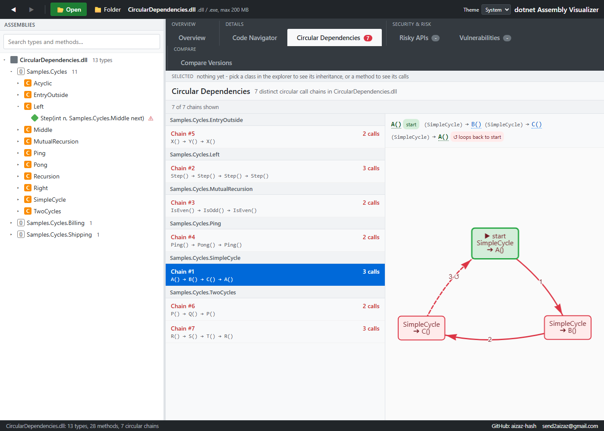

### Risky APIs

Calls to APIs that deserve a security review - unsafe deserializers, `Process.Start`, `Assembly.Load`, weak crypto, `DllImport`, disabled TLS checks and, because static analysis is blind there, reflection and dynamic code generation - with why each is risky, what to check, and links to the calling methods. These are **heuristic leads, not vulnerabilities**.

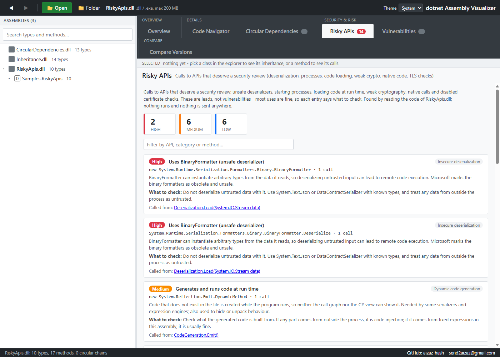

### Compare Versions

Choose two versions of an assembly (or start from the Overview with the open one as the old version) to list the changes in the public API, with the ones that can break callers marked - removed or changed members, narrower visibility, sealed types, added abstract members and so on - a suggested version bump, and Markdown / JSON export. Only metadata is read; nothing runs. It works without any assembly open.

### Light, dark and system themes

The **Theme** switch in the toolbar offers **System** (follows the operating system or browser setting, live), **Light** and **Dark**. The choice is remembered in the browser and applied before the page is painted. The graphs and the C# viewer follow the theme, and the text is readable (WCAG AA) in both.

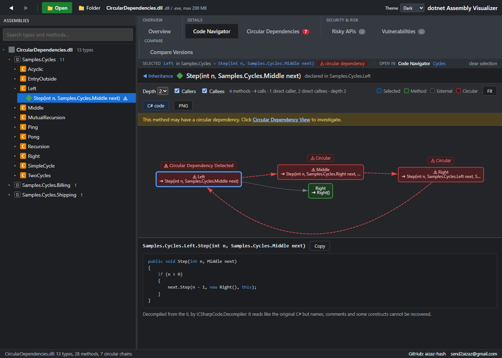

### Vulnerabilities Scan

The **Vulnerabilities** view checks the dependencies of the assembly you have loaded for known security vulnerabilities and puts **Critical and High** findings first. It looks up the *exact* package versions in [OSV.dev](https://osv.dev) (GitHub Security Advisories, NVD and others) - nothing is executed, installed or modified.

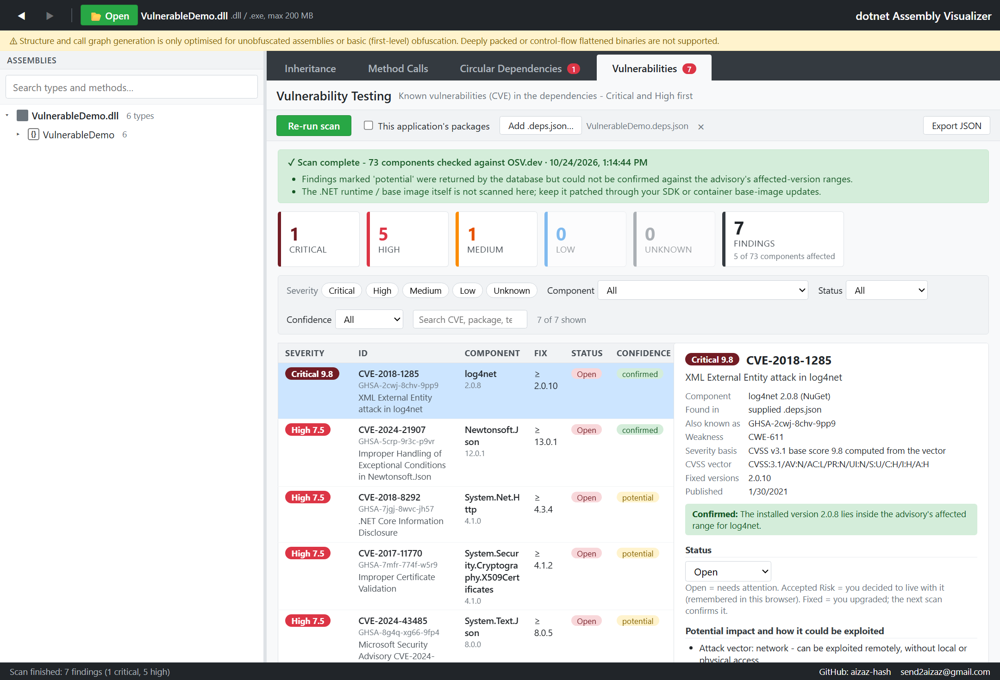

- **What is scanned:** the dependencies of the loaded assembly. With no extra file the scan reads the assembly's own references and follows the packages' dependencies (see *No manifest needed* below); a `.deps.json`, `project.assets.json` or `packages.lock.json` (*Add manifest…*, or open the folder it sits in) makes the versions exact. You can also tick *Also scan this tool's own packages* to check the packages this application itself ships with (not your assembly). The scan needs a loaded assembly: its result belongs to that assembly, is kept while you switch between assemblies, and disappears when you remove it. An assembly that only references the .NET runtime has no NuGet packages to check, and the view says exactly that instead of "database unreachable".
- **Automatic, in the background:** the first time you open an assembly, a small notification asks once whether dependencies may be checked automatically (only package names and versions are sent). After that, every assembly you open or select is scanned in the background - nothing blocks, the **Vulnerabilities Scan** tab shows a spinning ring while it runs and a count when it is done, and a short toast reports the result. A finished scan is reused for an hour while the file and its manifest are unchanged (no repeated lookups when you click between assemblies); a changed file, a newly found `.deps.json` or **Re-run scan** scans again, and a failed scan is not retried for two minutes. Switch it off with the **Scan automatically** checkbox in that view; manual scans keep working.
- **What you get for every finding:** CVE / GHSA identifier, CVSS score and severity (computed from the CVSS v3 vector, or the advisory's own rating when only a v4 vector is published), affected component and version, the weakness (CWE), potential impact and exploitation conditions derived from the vector, fixed versions, a recommended upgrade with a command *for you to run*, the advisory text and references.
- **Summary and filters:** counts per severity (click a card to filter), filters for severity, component, status and confidence, plus text search. Statuses are **Open**, **Accepted Risk** and **Fixed**; a finding you mark as fixed re-opens automatically if the next scan still reports it. Reports can be exported as **PDF** (the browser's print dialog - choose *Save as PDF*) or as JSON.
- **Confirmed, potential, informational:** every finding is verified against the advisory's affected-version ranges. It is **confirmed** when the exact version is known (from a manifest) and lies inside an affected range. It is **potential** when that cannot be established - the version was estimated from an assembly reference, or it was not found inside the advisory's listed ranges. It is **informational** when the package is one the .NET runtime supplies: whether the vulnerable code runs depends on the runtime's patch level, which a scan cannot see, so it is shown for awareness and is never counted by the command line's `--fail-on`. Heuristic findings are never presented as confirmed.

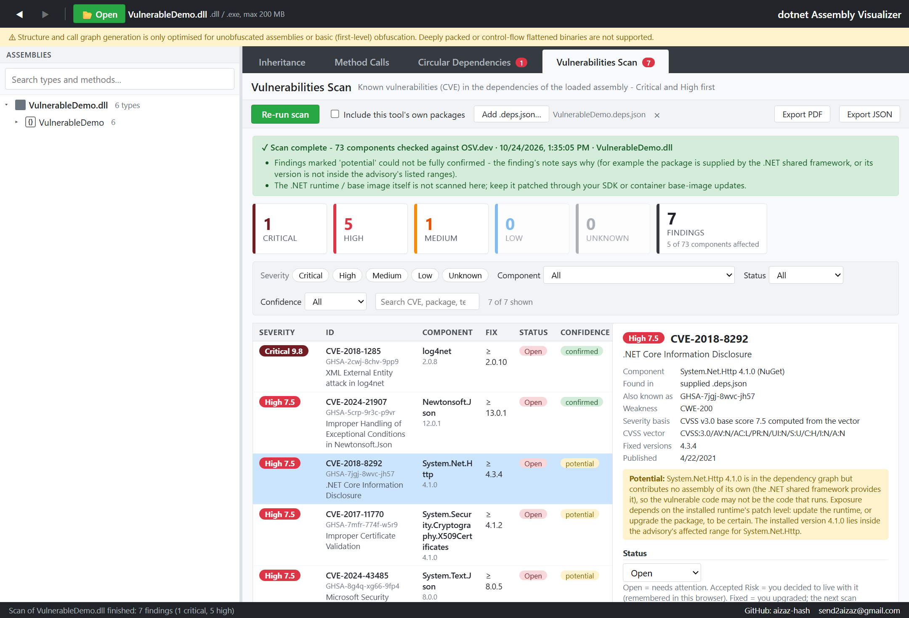

- **Honest about gaps:** if the database cannot be reached, a component fails, or an advisory cannot be downloaded, the report says the scan is **incomplete** instead of showing "no vulnerabilities". The .NET runtime / base image itself is not scanned.
- **No manifest needed:** the scan starts from the loaded assembly's own references (level 1), matches them to NuGet packages, then follows each package's declared dependencies down to **level 4** (level 0 is the assembly itself). Every dependency is listed once with its level, where its version came from (exact from a `.deps.json`, estimated from the assembly version, or the lowest version the parent accepts) and a plain status: *Assembly discovered*, *Package identified*, *Version identified*, *Vulnerability found*, *Vulnerability lookup unavailable* or *Dependency could not be resolved*. Findings with an estimated version are marked *potential*; adding the `.deps.json` makes versions exact.
- **Manifests:** add a `.deps.json`, `obj/project.assets.json` or `packages.lock.json` for exact versions - they also carry the dependency graph, so every package gets its level (and indirect packages are covered). Opening a folder or archive picks the right one automatically.
- **Privacy:** only package names and versions are sent to `api.osv.dev` and, to find a package's dependencies, `api.nuget.org` - never your code or assemblies - and the UI asks for confirmation before the first scan. Set `Vulnerability:Enabled` to `false` to switch the feature off (for air-gapped use).
- **Try it:** [`samples/vulnerabilities`](samples/vulnerabilities) is a deliberately vulnerable test assembly (log4net 2.0.8, Newtonsoft.Json 12.0.1, System.Text.Json 8.0.0). Build it, open the DLL and press *Run scan* (no manifest needed: findings are *potential*); add its `.deps.json` and they become *confirmed*, with System.Text.Json *informational*. See [samples/README.md](samples/README.md) for every sample.

### More

- Open an assembly with the **Open** button or by dragging a `.dll` / `.exe` onto the page; several assemblies can be loaded at once. You can also open a **NuGet package (`.nupkg`)**, a **`.zip`** or a whole **folder** (the **Folder** button, or drop a folder; in Chrome and Edge the button uses the browser's directory picker, which only asks to let the page *view* the folder, and then only the assemblies and the `.deps.json` are read - the `.pdb` and everything else is left alone; other browsers show their own "upload N files" prompt, which counts the whole folder): the best `lib/<framework>` assembly of a package, or the application assemblies of a publish folder, are opened (copies of the .NET framework are skipped, up to 8 at once) and the `.deps.json` that comes with them is used automatically for exact package versions in the Vulnerabilities Scan. They are listed in the explorer; click one to switch, and right-click it (or use the ✕ on hover) to **Reload** or **Remove** it.
- **Fit** and **PNG** export for graphs; the UI works offline (`vis-network` is bundled).
- Helpful errors for native or corrupt DLLs and a configurable upload limit; notifications are small toasts at the top right that disappear after a few seconds.
- Fully offline UI (except the optional vulnerability lookup).

---

## Quick start

### Docker (no .NET install required)

```bash
docker run --rm -p 8080:8080 ghcr.io/aizaz-hash/dotnet-visualizer-web:latest
```

Then open **http://localhost:8080** and upload a `.dll`. To use another host port, change the left side, e.g. `-p 5000:8080`.

To build the image yourself:

```bash
docker build -t dotnet-visualizer .
docker run --rm -p 8080:8080 dotnet-visualizer
```

The image has a `HEALTHCHECK` on `/healthz`; `docker ps` shows `healthy` once the app is up.

### Prebuilt downloads (no .NET install required)

Download the self-contained build for Windows (x64) or Linux (x64) from the [Releases page](https://github.com/Aizaz-hash/dotnet-Assembly-Visualizer/releases), extract it and run the `dotnet-Assembly-Visualizer` executable. The app listens on port 8080.

### From source

Requires the [.NET 8 SDK](https://dotnet.microsoft.com/download/dotnet/8.0).

```bash
git clone https://github.com/Aizaz-hash/dotnet-Assembly-Visualizer
cd dotnet-Assembly-Visualizer
dotnet run
```

Then open **http://localhost:8080**. This branch is the **v3** line, the current release. The earlier **v2** line stays available on its own branch (`git checkout v2`). The Docker image and the prebuilt downloads are built from the latest release.

### Windows service

`scripts/win/installer.ps1` publishes a self-contained build to `C:\DAV` and installs it as an auto-start Windows service (service name `DAV`, port 9999). Run it from an elevated PowerShell in the repository root.

---

## Using the UI

The views are arranged as a workflow: **Overview → Details → Security & risk → Compare.** Start at the left of the tab bar and move right; a newly opened assembly starts at **Overview**. The groups and views are listed in one place (`wwwroot/js/views.js`); see [docs/architecture/navigation.md](docs/architecture/navigation.md).

**Themes.** The **Theme** switch in the toolbar offers **System** (follows the operating system or browser setting and changes with it), **Light** and **Dark**. The choice is remembered in this browser and applied before the page is painted, so there is no flash. All colours are variables in `wwwroot/css/theme.css`; the graphs and the C# viewer follow the theme too.

**Selecting things (ILSpy-style).** Pick a **class** in the explorer and the **Code Navigator** opens with its inheritance and its C# code; expand the class to see its methods; pick a **method** and the Code Navigator shows its callers and callees with the method's C# code. The class and method you chose stay visible in the **Selected** bar under the tabs in every view, each part is a link back to its view, and a method that is part of a circular call chain carries a red **⚠ circular dependency** link to that cycle (also shown as a note in Method Calls and a ⚠ in the explorer). Back / Forward (Alt+Left / Alt+Right) retrace your steps.

| Area | What it does |
|---|---|
| **Toolbar** | *Open* an assembly, package or zip, *Folder*, Back / Forward. |
| **Explorer** | Lists the loaded assemblies (right-click: Reload, Remove); browse namespaces, types and methods; search for types and methods; methods in a circular chain carry a red ⚠. |

### 1 · Overview

One tab with a switch at the top of the page: **Summary | Architecture | Metrics**. The cards on the Summary open the matching screen. Before any assembly is open, only Overview and Compare Versions can be used; the other tabs, including the vulnerability scanner, are greyed out until a DLL is open. The Overview then is an introduction with two ways to start: open an assembly, or compare two versions.

| View | What it shows |
|---|---|
| **Summary** | What this assembly is, on one concise page: name, version, full name, culture, kind, platform, target framework, strong-name status with the **public key token**, module id (MVID), debug or release build, entry point, references and file size; the **obfuscation indicators** (evidence, never a verdict); and "At a glance" cards (types, methods, complexity, unreferenced methods, circular chains, risky API uses, vulnerabilities) that each open the matching view. A one-line hint at the top links to **Compare Versions** with this assembly already chosen as the old version. |
| **Architecture** | How namespaces depend on each other (built from calls and inheritance), and where namespaces or types depend on each other in a circle - each with a concrete path, clickable. Field and parameter types are not part of the analysis. |
| **Metrics** | Size and shape: method count, cyclomatic complexity (hotspots, histogram), IL size, most-called and most-dependent methods, largest types, and private/internal methods that nothing in the assembly references. *The unreferenced list is a lead, not proof* (reflection or another assembly can call them). |

### 2 · Details

| View | What it shows |
|---|---|
| **Code Navigator** | One screen for the selected class or method, with its C# code (ICSharpCode.Decompiler, the engine behind ILSpy, with syntax highlighting) always underneath - hide it with the **C# code** button. **A class** shows its *inheritance*: a graph (or tree) of base types, interfaces and derived types, or of the whole assembly; the depth choices come from the real hierarchy. **A method** shows its *calls*: callers and callees with an adjustable depth; each method appears once at its shortest distance; constructors are included. Picking another class or method updates both the graph and the code, and the selection is never changed by moving between views. |
| **Circular Dependencies** | Every distinct circular call chain, grouped by class; click a method to jump to its call graph. Direct recursion is not reported as a cycle. |

### 3 · Security & risk

| View | What it shows |
|---|---|
| **Risky APIs** | Calls to APIs that deserve a security review (unsafe deserializers, Process.Start, Assembly.Load, weak crypto, DllImport, disabled TLS checks, and - because static analysis is blind there - reflection and dynamic code generation) with why each is risky, what to check, and links to the calling methods. **Heuristic leads - not vulnerabilities.** |
| **Vulnerabilities** | Known advisories for the packages the assembly depends on (levels 1-4, no manifest needed), checked against OSV.dev. summary by severity, filters, remediation, status tracking, PDF / JSON / SBOM / SARIF export. |

### 4 · Compare

| View | What it shows |
|---|---|
| **Compare Versions** | Choose two versions of an assembly: the public API changes, with the ones that can break callers marked (removed or changed members, narrower visibility, sealed types, added abstract members...), a suggested version bump, and Markdown / JSON export. |

### How much to trust each result

| Kind | Where | Meaning |
|---|---|---|
| **Structure** | Overview (Summary, Architecture, Metrics), Code Navigator, Circular Dependencies | Facts read from the assembly's metadata and IL, within the limits below. A cycle is a design smell, not a vulnerability. |
| **Heuristic** | Risky APIs, unreferenced methods | A pattern that deserves a look. The tool never calls these vulnerabilities. |
| **Confirmed** | Vulnerabilities | The exact package version is known and lies inside an advisory's affected range. |
| **Potential** | Vulnerabilities | The version was estimated (no manifest) or could not be verified against the advisory's ranges. |
| **Informational** | Vulnerabilities | A package the .NET runtime supplies: whether the vulnerable code runs depends on the runtime's patch level, which a scan cannot see. Shown for awareness; never counted by the command line's `--fail-on`. |

### Limitations

* **Obfuscation.** Structure and call-graph analysis is most accurate for unobfuscated assemblies. What was verified (see [`samples/obfuscation`](samples/obfuscation)): renamed members are listed under their obfuscated names, inheritance and calls survive renaming, and calls inside control-flow-flattened methods are still found (their order is lost and their complexity is very high). What cannot be resolved: packed or encrypted method bodies that are decrypted at run time, deliberately malformed metadata, and code generated at run time. When part of a file cannot be read the load says so, and the results are incomplete.
* **Calls that are not visible in the IL.** A call made through reflection (a method name in a string) is not an edge. A call through an interface or a delegate points at the interface / delegate, not at every implementation, so cycles that run through interface dispatch are not found.
* **Dependencies.** A scan without a manifest estimates package versions from assembly references and marks the findings *potential*; add a `.deps.json`, `project.assets.json` or `packages.lock.json` for exact versions.
* **Reference assemblies** (API only) contain no code; the load says so.

---

## Configuration

| Setting | Default | Notes |
|---|---|---|
| `Urls` | `http://*:8080` | Where the app listens. The Docker image pins it to `8080` through an environment variable. |
| `Upload:MaxFileSizeMB` | `200` | Maximum assembly size. Set it in `appsettings.json` or with the environment variable `Upload__MaxFileSizeMB`, e.g. `docker run -e Upload__MaxFileSizeMB=500 ...`. The UI shows the active limit next to *Open*. |
| `Vulnerability:Enabled` | `true` | Switch the vulnerability lookup off (e.g. air-gapped). Env var: `Vulnerability__Enabled`. |
| `Vulnerability:OsvBaseUrl` | `https://api.osv.dev/` | Vulnerability database endpoint (OSV API). |
| `Vulnerability:NuGetBaseUrl` | `https://api.nuget.org/v3-flatcontainer/` | NuGet flat container used to find packages and their dependencies. |
| `Vulnerability:TimeoutSeconds` | `20` | Timeout for each database request. |

Third-party: the **Code Navigator** uses [ICSharpCode.Decompiler](https://github.com/icsharpcode/ILSpy) (MIT licence) and the graphs use vis-network.

Endpoints: `POST /api/analysis/analyze` (analyse an uploaded assembly), `POST /api/analysis/diff` (public API changes between two versions), `POST /api/decompile` + `GET /api/decompile/{id}?token=` (C# source), `GET /api/analysis/limits`, `POST /api/vulnerabilities/scan`, `GET /api/vulnerabilities/status`, `GET /healthz`.

---

## How it works

- **Engine:** reads the PE metadata and scans IL bytes for `call` and `callvirt` opcodes to build the inheritance and call graphs; lambdas and compiler-generated methods are resolved back to the source methods that contain them.
- **Circular chains:** detected with a depth-first search over the call graph; the UI merges rotations of the same cycle so each chain is listed once.
- **Backend:** ASP.NET Core with a modular structure (`Controllers`, `Services`, `Interfaces`); `IAssemblyAnalyzer` and `ICircularDependencyDetector` are registered through dependency injection.
- **C# code:** [ICSharpCode.Decompiler](https://github.com/icsharpcode/ILSpy) decompiles the selected type or method on demand; the server keeps the assembly in memory for a few minutes so clicking through methods is quick. Nothing is executed.
- **Metrics, risky APIs and API changes:** cyclomatic complexity and size come from the same IL scan as the call graph; the risky-API rules and the public API differ read metadata only.
- **Frontend:** plain HTML, CSS and JavaScript (no bundler) with [vis-network](https://visjs.github.io/vis-network/) for graphs. The views are declared once in `wwwroot/js/views.js`; every colour is a theme token in `wwwroot/css/theme.css`. See [docs/architecture/navigation.md](docs/architecture/navigation.md).

---

## Command line and CI

The same scan runs headless, for pipelines. It exits non-zero when a finding is at or above a severity, and it can write a SARIF file (GitHub code scanning) and a CycloneDX SBOM.

```bash
# from a build output (the .deps.json next to the assembly is used automatically)
dotnet dotnet-Assembly-Visualizer.dll scan bin/Release/net8.0/MyApp.dll --fail-on high --sarif scan.sarif --sbom sbom.cdx.json

# or with the container image
docker run --rm -v "$PWD:/work" ghcr.io/aizaz-hash/dotnet-visualizer-web:latest scan /work/MyApp.dll --fail-on high --sarif /work/scan.sarif
```

| Option | Meaning |
|---|---|
| `--manifest <file>` | `.deps.json`, `project.assets.json` or `packages.lock.json` for exact versions and levels (default: `<assembly>.deps.json` next to the assembly) |
| `--fail-on critical\|high\|medium\|low\|none` | exit code 1 when a finding is at or above it (default `high`) |
| `--allow-incomplete` | do not fail (exit 3) when not everything could be checked, e.g. no network |
| `--max-level 1-4` | how deep to follow package dependencies when there is no manifest |
| `--sarif`, `--sbom`, `--json <file>` | write SARIF 2.1.0, a CycloneDX 1.5 SBOM, or the full report |

Exit codes: `0` ok, `1` findings at/above `--fail-on`, `2` bad arguments or unreadable file, `3` scan incomplete (an unreachable database is never reported as a clean pass). Set `VULN_OSV_URL` / `VULN_NUGET_URL` to use a mirror.

A GitHub Action wraps it (`action.yml` in this repository):

```yaml
- uses: Aizaz-hash/dotnet-Assembly-Visualizer@v3
  with:
    assembly: src/MyApp/bin/Release/net8.0/MyApp.dll
    fail-on: high
- uses: github/codeql-action/upload-sarif@v3
  if: always()
  with:
    sarif_file: dependency-scan.sarif
```

In the web UI, **Export SBOM** and **Export SARIF** produce the same files from the scan on screen.

---

## Project structure

```
Controllers/     HTTP API (analysis, decompile, vulnerabilities)
Services/        AssemblyAnalyzerService, CircularDependencyDetectorService, AssemblyInsights (identity, obfuscation indicators), RiskyApiRules
Services/ApiDiff/           public API differ (Compare Versions)
Services/Decompilation/     C# decompiler service
Services/Vulnerabilities/   OSV + NuGet clients, dependency resolver (levels 1-4), CVSS calculator, version ranges, scanner
Services/Cli/               the command line (scan, SBOM, SARIF)
Interfaces/      IAssemblyAnalyzer, ICircularDependencyDetector
util/            shared helpers
wwwroot/         index.html, css/ (styles.css, theme.css = every colour per theme), js/ (views.js = the list of views, one script per area), lib/ (bundled vis-network)
tests/           automated tests: Unit/ (one component, fakes for the network), Integration/ (the real analyzer, scanner and API on the sample assemblies), Support/, js/ (node --test) and ui/ (the whole interface in a real browser)
tools/PerfPoc/   per-stage timing benchmark for the analyzer (see docs/performance/PERFORMANCE_REPORT.md)
samples/         sample assemblies to open and explore - one folder per scenario, documented in samples/README.md (they are inputs, not tests)
scripts/         Windows service installer (win/), JS fixture generator, screenshots.mjs (retakes the screenshots in docs/images)
docs/            architecture/ (navigation, views and themes), images/ (screenshots used in this README), qa/, release/, performance/
.github/         CI and release workflows
```

---

## Testing

```bash
dotnet test tests/DotNetVisualizer.Web.Tests -c Release                                   # everything (builds the sample assemblies first)
dotnet test tests/DotNetVisualizer.Web.Tests -c Release --filter "FullyQualifiedName~Tests.Unit"          # unit tests only
dotnet test tests/DotNetVisualizer.Web.Tests -c Release --filter "FullyQualifiedName~Tests.Integration"   # integration tests only
node --test tests/js/*.test.js                                                             # browser-side logic
node --test tests/ui/*.test.mjs                                                            # the whole interface in a real browser (about 5 minutes)
```

* **Unit tests** check one component at a time (CVSS and version ranges, the scanner and resolver with a fake OSV / NuGet, the exporters, the command line, the decompiler service, the API differ, the metrics and risky-API rules).
* **Integration tests** run the real analyzer, scanner, API differ and command line on the real [sample assemblies](samples/README.md): every "EXPECTED" statement in a sample's source header is asserted. Only OSV.dev and NuGet are replaced by fakes.
* **JavaScript tests** cover the depth model, the layout, the architecture analysis, the click and loader logic, and (from real analyzer output for three samples, `tests/js/fixtures`) the model behind the Method View -> Circular Dependency link. `scripts/update-js-fixtures` regenerates the fixtures and an integration test fails if they are stale.

* **The screenshots** in `docs/images/v3-*.png` are retaken from the real app with `node scripts/screenshots.mjs` (same requirements as the UI test); the vulnerability screenshots need the network and are kept from v2.
* **The UI test** (`tests/ui`) is one end-to-end test of the whole interface. It starts the app, opens a headless Edge / Chrome through the DevTools protocol (no extra packages), loads the sample assemblies and a large real library through the file input and then clicks like a user: start-up (no flash of a half-built page), every class and method of every sample (view, graph highlight, the right C# code), circular dependencies (warnings, chains, direction, no false cycles), navigation sequences with Back and Forward, search, bad files, Light / Dark / System (including the system theme changing live), readability of all text in both themes, layout from desktop to phone width, and speed on a big assembly. It needs the app and the samples built (run `dotnet test` once) and a Chromium browser; without them it is skipped and says why. Options: `UI_TEST_URL` (use a running app), `UI_BROWSER`, `UI_SAMPLES`, `UI_TEST_BUILD=1`.

The tests call no external service (OSV.dev and NuGet are faked), but building the sample assemblies restores their NuGet packages once, so the first build needs internet access. CI runs everything on every pull request, including the UI test in headless Chrome.

---

## Releasing

Releases are built by the *Release* workflow and always use the **current tip of the release branch** (`main` for `0.x`, `v<major>` for everything else - `v2` for `2.x`, `v3` for `3.x`). The latest release is **v3.0.0** ([notes](docs/release/release-notes-v3.0.0.md)). The *Latest* badge and the Docker `latest` tag follow the **v3** branch (`LATEST_BRANCH` in the workflow), so a v2 patch release does not take them over:

1. Merge everything for the release into the release branch.
2. GitHub → *Actions* → *Release* → *Run workflow*, choose the branch and enter the version (e.g. `2.0.1`). The workflow builds that branch's latest commit, publishes the GHCR image and the archives, and creates or moves the tag `v<version>` onto exactly that commit.

Pushing a tag by hand also works, but the workflow fails if the tag is not the tip of its release branch, so a stale tag cannot publish old code. Each release page states the branch and commit it was built from.

---

## License

This project is released under the **[MIT License](LICENSE)** - Copyright (c) 2026 Aizaz Zaheen.

The MIT License is a permissive, free-software license. Under its terms you may use, copy, modify, merge, publish, distribute, sublicense and sell copies of this software - for personal, educational and commercial purposes - free of charge, provided that the copyright notice and the permission notice are included in all copies or substantial portions of the software. The software is provided "as is", without warranty of any kind. See the [LICENSE](LICENSE) file for the full text.

---

## Contributing and contact

Bug reports, ideas and pull requests are welcome - open an issue or a PR on [GitHub](https://github.com/Aizaz-hash/dotnet-Assembly-Visualizer). I'd love to hear how you're using it.

- **GitHub:** [aizaz-hash](https://github.com/aizaz-hash)
- **Blog:** [articles about the project](docs/blog/README.md)
- **Email:** [send2aizaz@gmail.com](mailto:send2aizaz@gmail.com?subject=Assembly%20Visualizer)

*Built by [Aizaz](https://github.com/aizaz-hash) - happy coding!*
