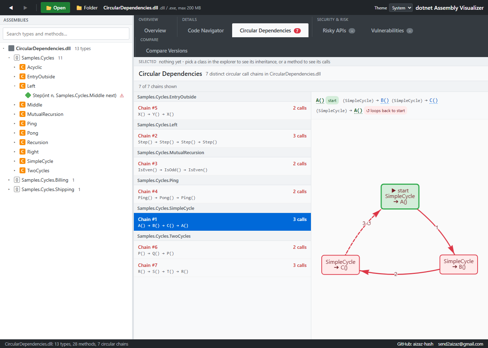

# Finding circular dependencies in a .NET assembly without running it

*2026-11-01 · by Aizaz*

"Class A uses class B and class B uses class A" is easy to spot in a ten-class sample. In a real assembly with thousands of methods you need a tool, and I wanted one that does not load the assembly or run any of it. This post explains how .NET Assembly Visualizer finds circular call chains, and where the method stops being able to see.

## Step 1: read the IL, not the source

A compiled .NET method is a sequence of IL instructions. A call is an instruction (`call`, `callvirt`, `newobj`) that carries a metadata token pointing at the target method. The tool reads the assembly with `System.Reflection.Metadata`, walks every method body, and records each call token as an edge from the calling method to the target.

A few details matter for the result to make sense:

- **Targets are resolved once.** A target method is looked up once and reused at every call site. Resolving it again at each call site made opening a mid-size assembly feel stuck; fixing that took one real assembly from seconds to a fraction of a second.
- **Constructors count.** `new Foo(...)` and `base(...)` are edges, so a cycle that passes through a constructor is found. Two classes that create each other in their constructors are a real circular dependency.
- **Lambdas are mapped back.** The compiler moves a lambda body into a generated method with an unreadable name. The tool resolves it back to the source method that contains it, so a cycle through a lambda shows up under the name you wrote.

## Step 2: a depth-first search for loops

With the graph built, finding cycles is a depth-first search that notices when it reaches a method already on the current path. The same cycle can be found from any of its members, so `A → B → C → A` and `B → C → A → B` are the same chain. The tool keeps one of them, so each chain is listed once.

Two choices that are easy to get wrong:

- **Direct recursion is not a cycle.** A method that calls itself (a factorial, a tree walk) is not reported. It is normal code, and listing it would drown the real findings.
- **Every chain must be a real loop.** Each consecutive pair in a chain must be an actual call, and the last method must call the first. The tool's automated UI test checks this for every chain it reports, and checks that assemblies without cycles report none.

## Step 3: show it where you are looking

A list of chains is only useful if it follows what you are examining. In the Circular Dependencies view the chains are filtered to the class or method you have selected, or you can show all of them. Selecting a class shows the chains through any of its methods. The selection bar above every view carries a badge when the selected class or method is part of a chain, and clicking it opens the filtered list.

## What it cannot see

I would rather tell you than let you find out.

- **Reflection.** A call made through a string method name is not an edge in the IL.
- **Interfaces and delegates.** A call through an interface points at the interface method, not at every implementation, so a cycle that only exists through dynamic dispatch is not found.
- **Obfuscation.** Renamed members are shown under their obfuscated names, and packed or encrypted method bodies cannot be read. The Overview says this on the page about the assembly, and it also reports signs of obfuscation as evidence rather than a verdict.

## Try it

Open any assembly in .NET Assembly Visualizer and look at the **Circular Dependencies** tab. The repository has small sample assemblies for each case above, in the `samples` folder, so you can see the simple loop, the longer one, a class in two cycles and the direct-recursion case that is correctly left out.

[github.com/Aizaz-hash/dotnet-Assembly-Visualizer](https://github.com/Aizaz-hash/dotnet-Assembly-Visualizer)
