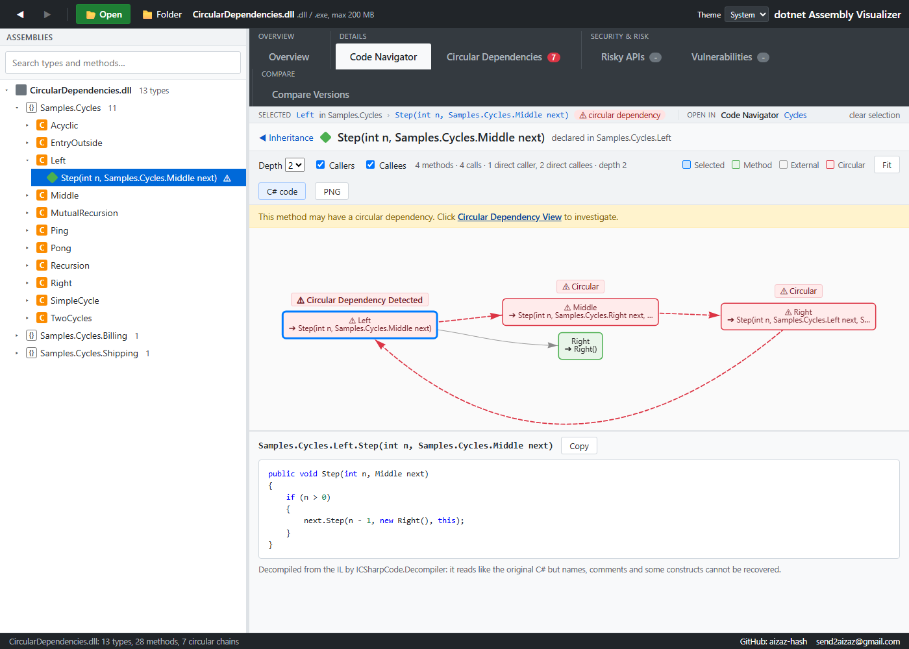
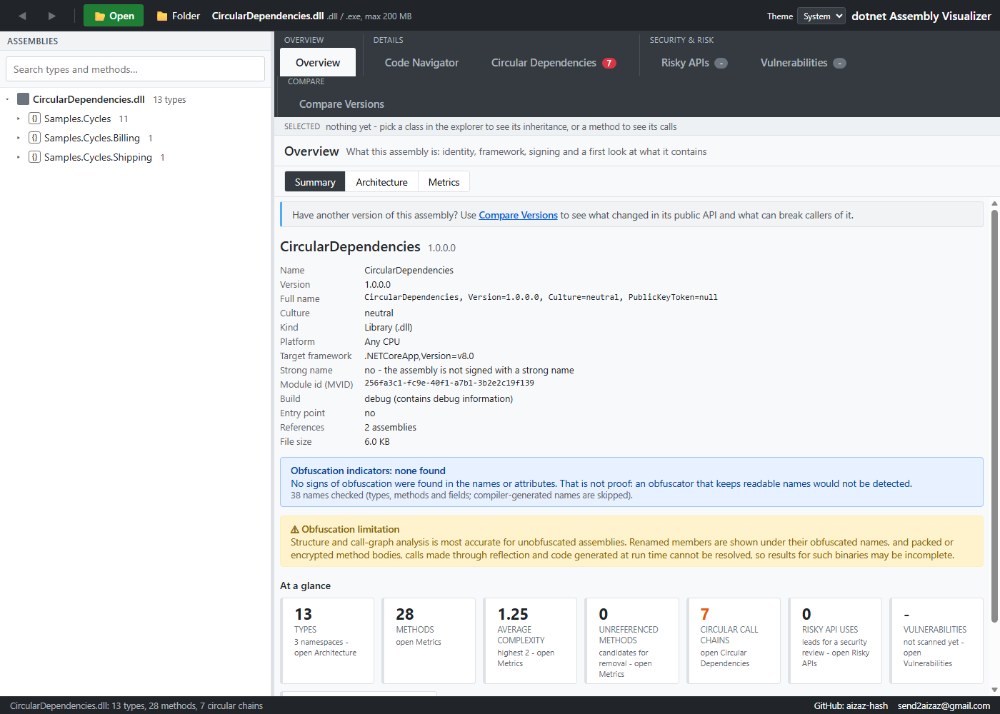
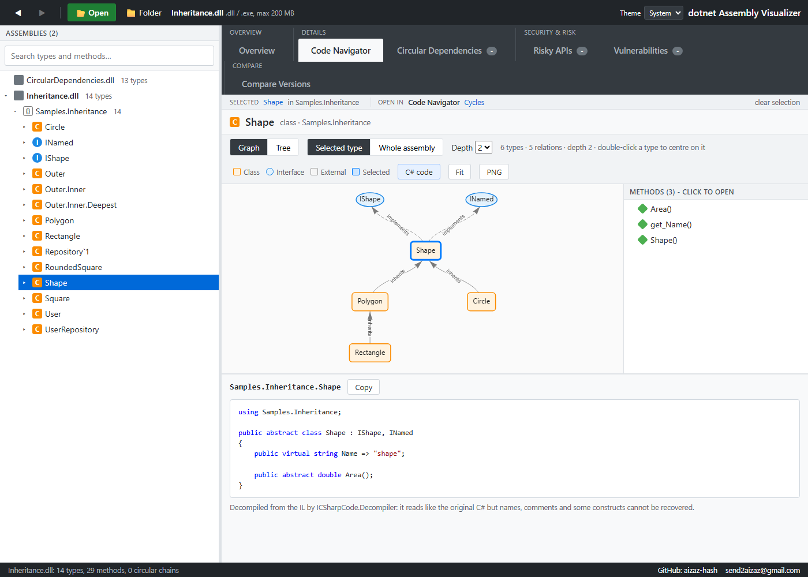
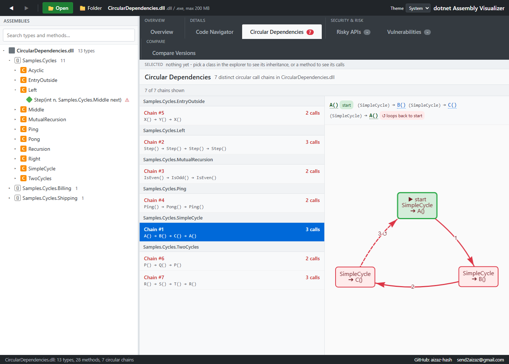
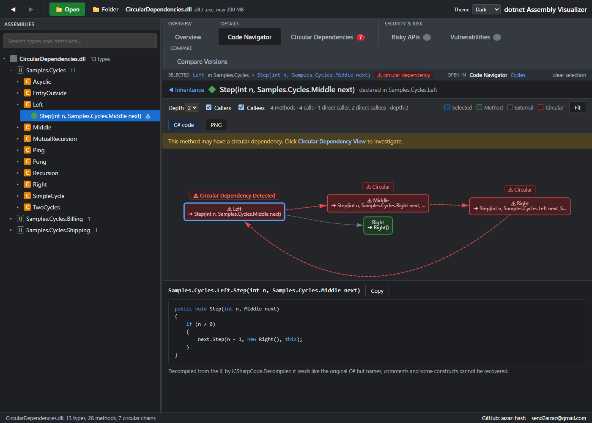

# Introducing .NET Assembly Visualizer v3

*2026-11-01 · by Aizaz*

I built .NET Assembly Visualizer because I was tired of staring at huge, unreadable dependency graphs whenever I had to understand a big .NET assembly. v2 gave it four views. v3, released today, turns them into one workflow and adds what I kept reaching for next to them: the code itself, a security view, a way to compare versions, and a dark theme.

You open a DLL (or an EXE, a NuGet package, a zip, a folder) and read it. Nothing is loaded into a runtime, nothing is executed: the tool reads the metadata and the IL directly.



## One path through the assembly

The tabs follow the order I actually ask questions in:

1. **Overview** - what is this assembly? Name, version, target framework, strong-name status and public key token, build type, references, and indicators of obfuscation. Two more screens sit behind a switch: **Architecture** (how its namespaces depend on each other) and **Metrics** (complexity hotspots, the biggest types, methods that nothing calls).
2. **Details** - the **Code Navigator** and the **Circular Dependencies** view.
3. **Security & risk** - risky API calls and known vulnerabilities in the dependencies.
4. **Compare** - what changed in the public API between two versions.



## Pick something, see everything about it

This is the part I like most. In the **Code Navigator** you pick a *class* and you see its inheritance as a graph (bases above, derived types below), with its decompiled C# right under it. You pick a *method* and you see its callers and callees, again with its code underneath. You never have to open a second tool to read what the graph is showing.



What you picked stays picked. Move to the Circular Dependencies view and it filters to your class or method; move back and the same selection is still there. A bar above every view shows it and links to the other views.

## Circular dependencies, with the exact path

If a method takes part in a circular call chain, you see it everywhere: a marker in the explorer, a badge in the selection bar, and a "Circular Dependency Detected" tag in the call graph. The dedicated view lists each distinct chain as `A() → B() → C() → A()`, with the start and the loop-back marked.



## Security, kept honest

**Risky APIs** lists calls that deserve a review - unsafe deserializers, process start, dynamic code loading, weak crypto, disabled TLS checks - and says what to check. They are leads, not vulnerabilities, and the tool never calls them that.

**Vulnerabilities** looks up the exact package versions of your dependencies in OSV.dev. It runs in the background when you open an assembly, and it tells you plainly when a scan is incomplete instead of showing "no vulnerabilities". Only package names and versions are sent anywhere, never your code.

## Compare two versions

Pick an old and a new version of an assembly and get the changes in the public API, with the ones that can break callers marked: removed or changed members, narrower visibility, sealed types, new abstract members. It suggests a version bump and exports Markdown or JSON.

## Light, dark, or whatever your system uses

A theme switch in the toolbar: Light, Dark, or System, which follows your operating system and changes with it while the app is open.



## For your pipeline too

The same vulnerability scan runs headless: `scan` on the command line, SARIF for GitHub code scanning, a CycloneDX SBOM, and a GitHub Action.

## Try it

```bash
docker run --rm -p 8080:8080 ghcr.io/aizaz-hash/dotnet-visualizer-web:3.0.0
```

Then open http://localhost:8080. Windows and Linux builds that need no .NET install are on the [release page](https://github.com/Aizaz-hash/dotnet-Assembly-Visualizer/releases), and the code is MIT licensed on [GitHub](https://github.com/Aizaz-hash/dotnet-Assembly-Visualizer). Bug reports, ideas and pull requests are welcome.
